# RetroBox

Loja virtual de games e consoles retrô.

**Integrante:** Kauã Santos Soares

**Repositório:** https://github.com/kauasantos29/Sistema-Web-RetroBox

## Tema

Loja de jogos retrô (Super Nintendo, Mega Drive, PlayStation 1, Nintendo 64, Game Boy e outros), com informações de ano de lançamento e estado de conservação de cada jogo.

## Descrição do sistema

O RetroBox é um sistema web para venda de jogos retrô. Ele tem duas partes:

- **Loja (pública):** o cliente vê os jogos, busca pelo nome, filtra por plataforma, abre os detalhes de cada jogo, cria sua conta, monta o carrinho, finaliza o pedido e acompanha seus pedidos.
- **Área administrativa:** acesso restrito por login. Gerencia plataformas, jogos, clientes, pedidos e usuários, e mostra um resumo das vendas no painel.

## Tecnologias

- PHP 8
- MySQL
- PDO
- Programação Orientada a Objetos
- MVC
- HTML, CSS e JavaScript
- XAMPP

## Regras de negócio

1. Somente usuários logados acessam a área administrativa.
2. Somente administradores podem gerenciar usuários.
3. As senhas são salvas com `password_hash()`.
4. O e-mail de usuários e de clientes não pode se repetir.
5. Para se cadastrar, o cliente informa nome, e-mail, telefone e senha.
6. Todo jogo pertence a uma plataforma.
7. Uma plataforma que tem jogos cadastrados não pode ser excluída.
8. O estado de conservação do jogo pode ser: Lacrado, Completo ou Só o cartucho.
9. Não é possível adicionar ao carrinho mais unidades do que o estoque.
10. Jogos com estoque zerado aparecem como esgotados.
11. Para finalizar um pedido, o cliente precisa estar logado.
12. Ao finalizar um pedido, o estoque dos jogos é reduzido.
13. O item do pedido guarda o preço do dia da compra.
14. O status do pedido pode ser: Pendente, Pago, Enviado, Entregue ou Cancelado.
15. Ao cancelar um pedido, o estoque dos jogos volta.
16. Um pedido cancelado não pode mudar de status.
17. Só é possível excluir pedidos cancelados.
18. Um jogo que já foi vendido não pode ser excluído.
19. Um cliente que já fez pedidos não pode ser excluído.
20. O administrador não pode excluir a própria conta.

## Diagrama de classes

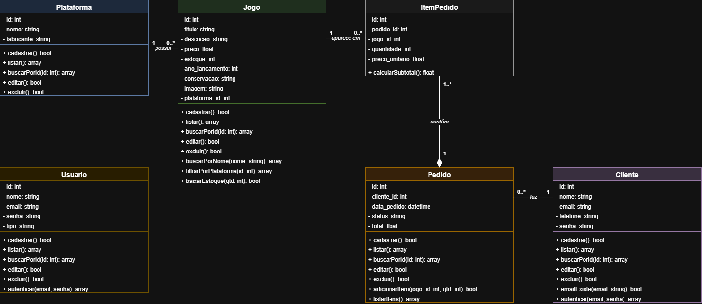

## Modelo do banco de dados

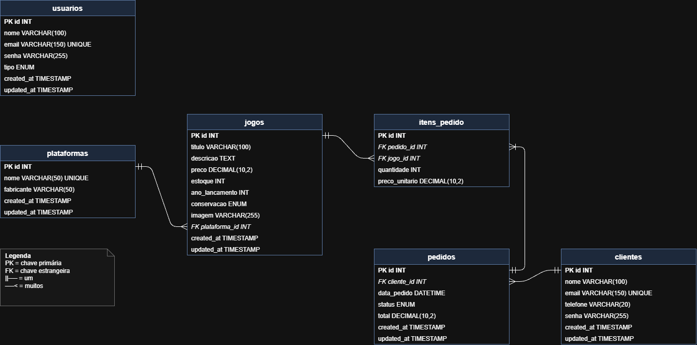

Tabelas: `usuarios`, `clientes`, `plataformas`, `jogos`, `pedidos` e `itens_pedido`.

## Estrutura do projeto

```
retrobox/
├── config/         conexão com o banco e sessão
├── models/         Usuario, Cliente, Plataforma, Jogo, Pedido e Carrinho
├── controllers/    recebem os formulários e chamam os models
├── views/
│   ├── loja/       páginas públicas
│   └── admin/      área administrativa
├── public/         css, js e imagens dos jogos
├── docs/           diagramas e prints
├── banco.sql
└── index.php
```

## Como instalar e executar

1. Instale o XAMPP (PHP 8).
2. Coloque a pasta do projeto em `C:\xampp\htdocs\retrobox`.
3. Inicie o Apache e o MySQL no painel do XAMPP.
4. Abra o phpMyAdmin, vá na aba SQL, cole o conteúdo de `banco.sql` e execute.
5. Acesse a loja em `http://localhost/retrobox/`.
6. Acesse a área administrativa em `http://localhost/retrobox/views/login.php`.

## Usuários de teste

| Tipo | E-mail | Senha |
|---|---|---|
| Administrador | kauasantos29.kss@gmail.com | adm123 |
| Cliente | matheusfernando@gmail.com | user123 |
| Cliente | juliocesar@gmail.com | user123 |
| Cliente | vitorbotelho@gmail.com | user123 |

## Funcionalidades

**CRUDs**

- Usuários
- Clientes
- Plataformas
- Jogos
- Pedidos

**Autenticação**

- Login e logout de administradores
- Cadastro, login e logout de clientes na loja
- Controle de sessão e proteção da área administrativa

**Extras**

- Busca de jogos pelo nome
- Filtro por plataforma
- Página de detalhes do jogo
- Upload de imagem
- Carrinho de compras
- Controle de estoque
- Dashboard administrativo
- Validação de formulários com JavaScript

## Telas

### Loja

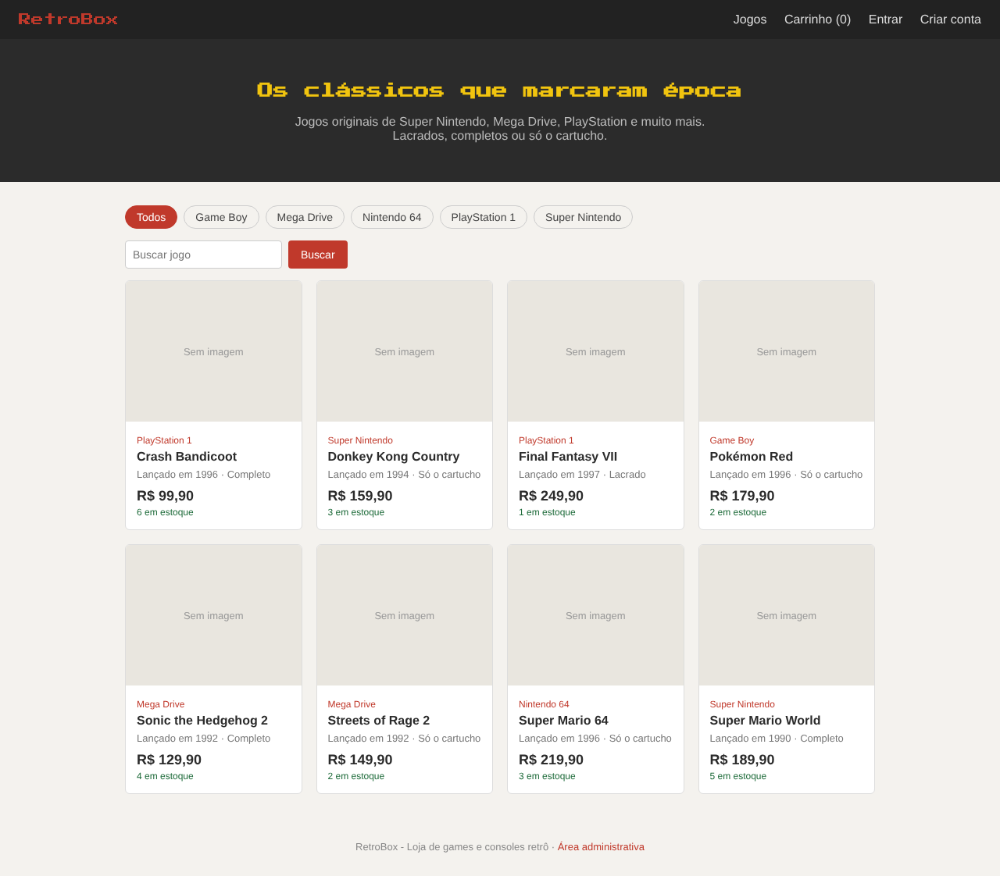

### Detalhes do jogo

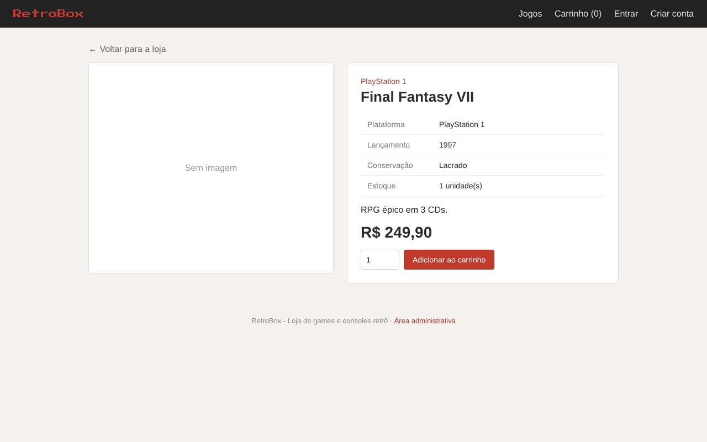

### Cadastro de cliente

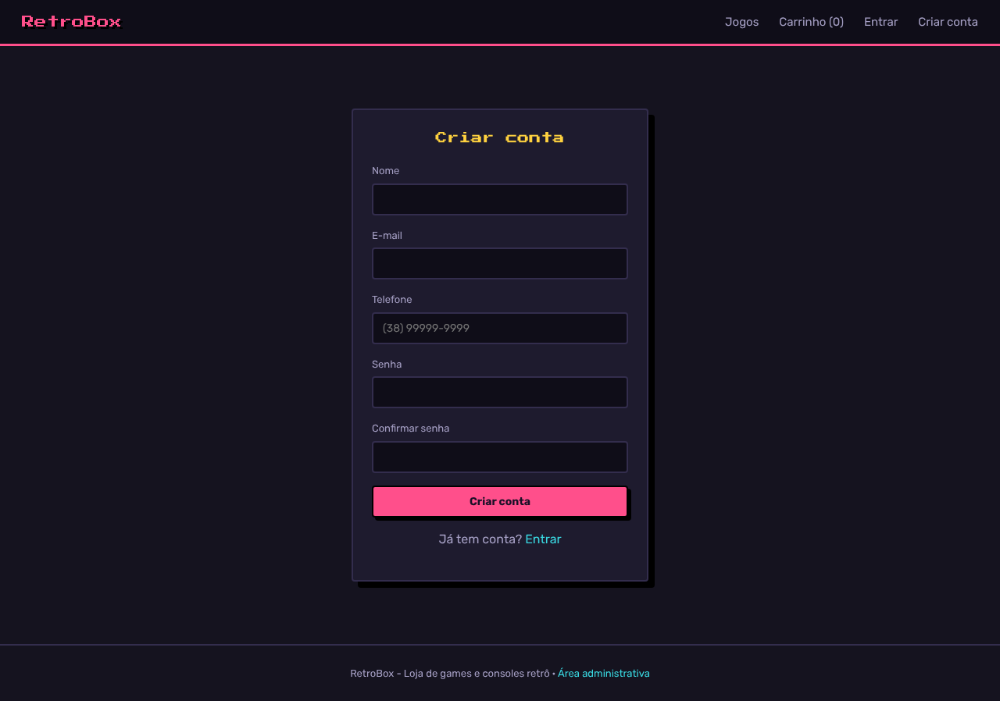

### Carrinho

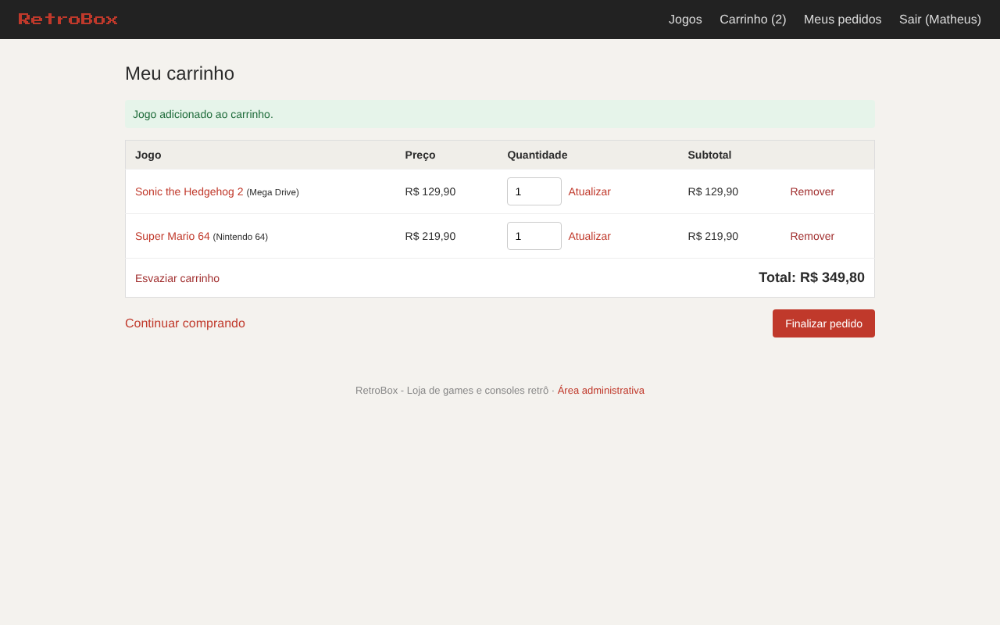

### Meus pedidos

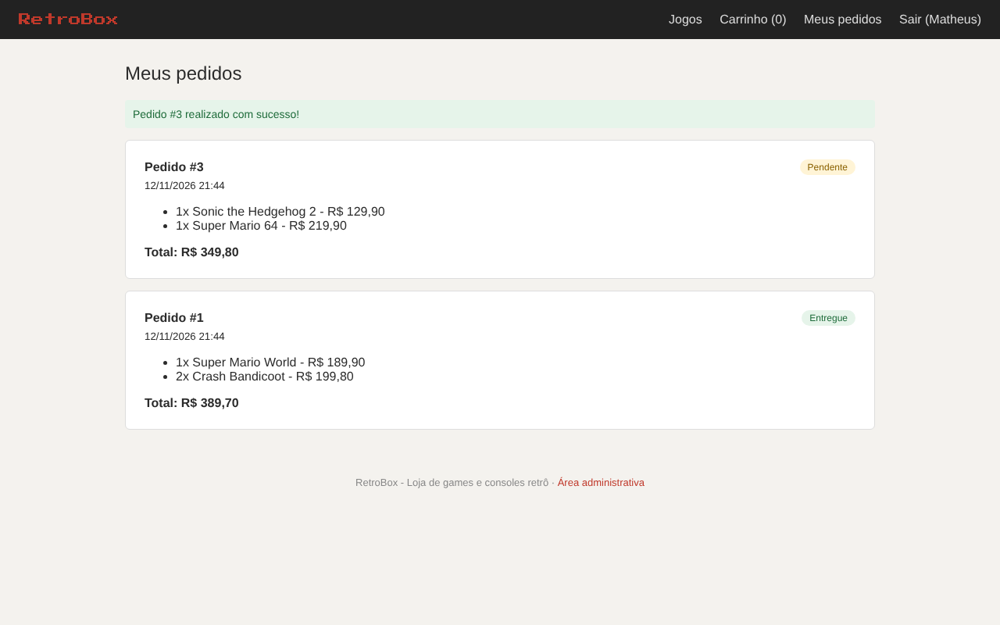

### Login administrativo

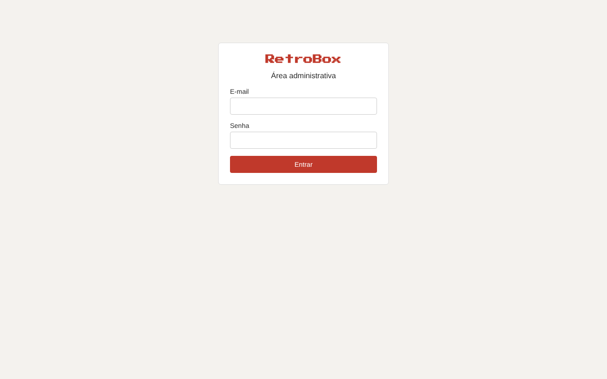

### Dashboard

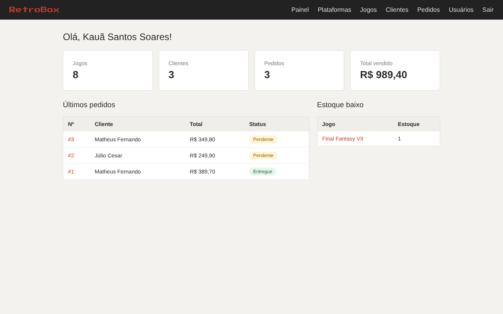

### Jogos

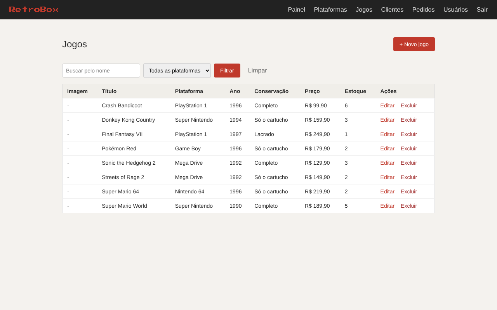

### Editar jogo

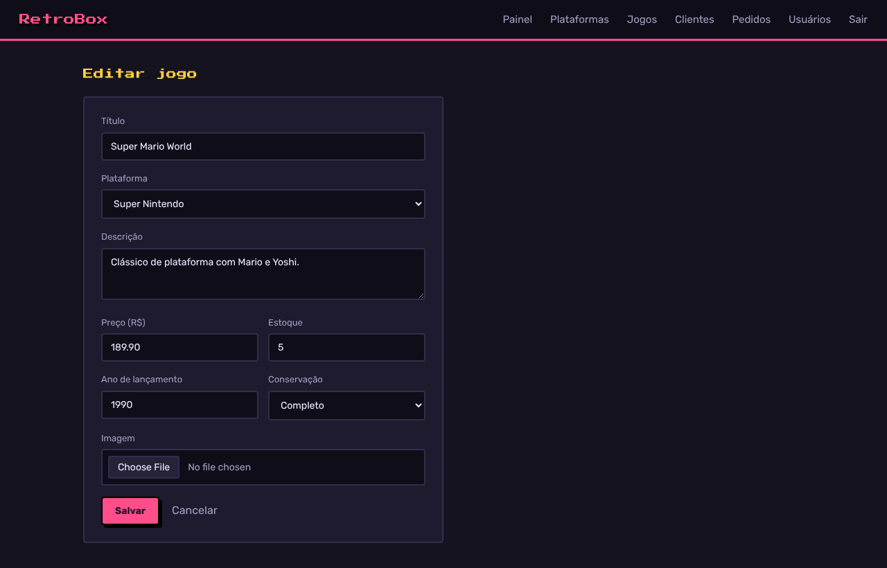

### Pedidos

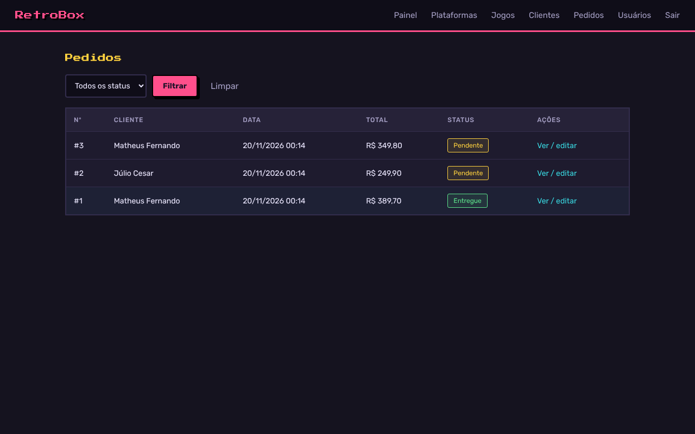

### Detalhes do pedido

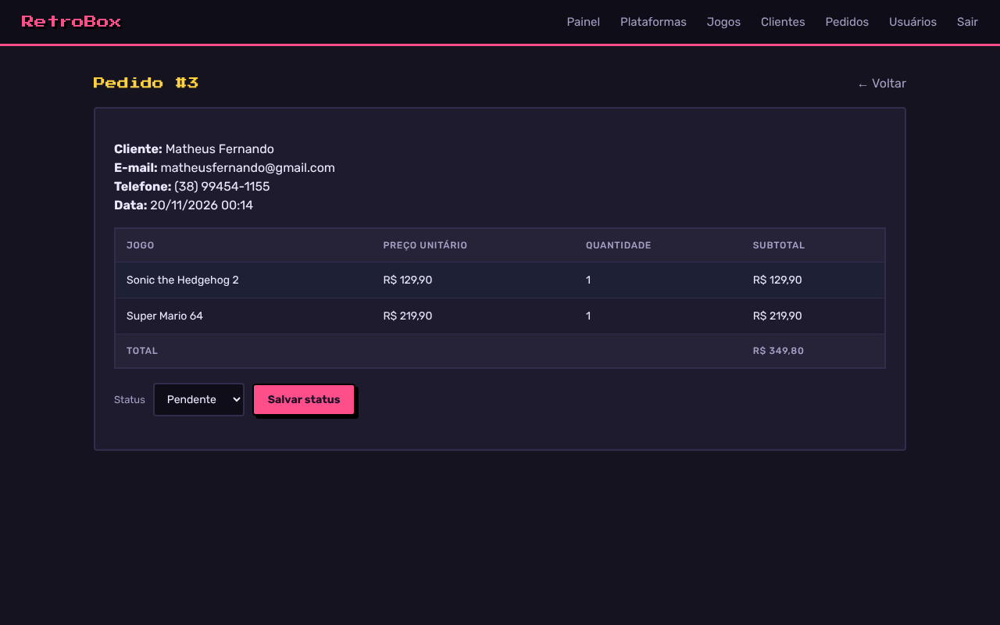
