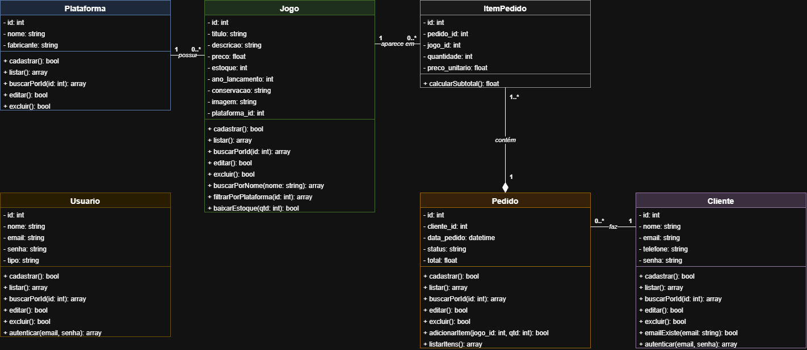
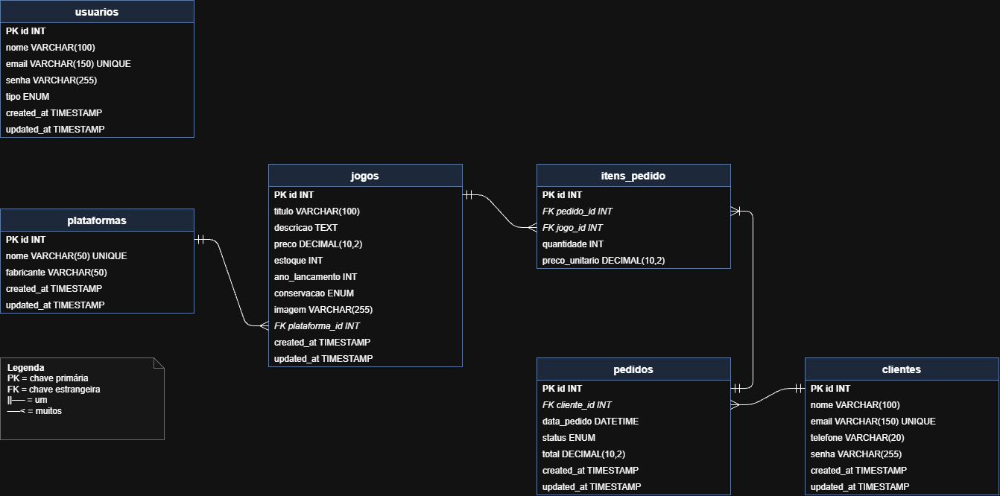

# RetroBox

Loja virtual de games e consoles retrô.

**Integrante:** Kauã Santos Soares

**Repositório:** https://github.com/kauasantos29/Sistema-Web-RetroBox

## Tema

Loja de jogos retrô (Super Nintendo, Mega Drive, PlayStation 1, Nintendo 64, Game Boy e outros), com informações de ano de lançamento e estado de conservação de cada jogo.

## Descrição do sistema

O RetroBox é um sistema web para venda de jogos retrô. Ele tem duas partes:

- **Loja (pública):** o cliente vê os jogos, busca pelo nome, filtra por plataforma, vê os detalhes de cada jogo, cria sua conta, monta o carrinho e finaliza o pedido.
- **Área administrativa:** acesso restrito por login. O administrador gerencia usuários, clientes, plataformas, jogos e pedidos, e acompanha um resumo das vendas no dashboard.

## Tecnologias

- PHP 8
- MySQL
- PDO
- Programação Orientada a Objetos
- MVC
- HTML, CSS e JavaScript
- XAMPP

## Regras de negócio

1. Somente usuários logados acessam a área administrativa.
2. As senhas são salvas com `password_hash()`.
3. O e-mail de usuários e de clientes não pode se repetir.
4. Para se cadastrar, o cliente informa nome, e-mail, telefone e senha.
5. Todo jogo pertence a uma plataforma.
6. Uma plataforma que tem jogos cadastrados não pode ser excluída.
7. O estado de conservação do jogo pode ser: Lacrado, Completo ou Só o cartucho.
8. Não é possível adicionar ao carrinho mais unidades do que o estoque.
9. Jogos com estoque zerado aparecem como esgotados.
10. Para finalizar um pedido, o cliente precisa estar logado.
11. Ao finalizar um pedido, o estoque dos jogos é reduzido.
12. O item do pedido guarda o preço do dia da compra.
13. Um cliente que já fez pedidos não pode ser excluído.
14. O status do pedido pode ser: Pendente, Pago, Enviado, Entregue ou Cancelado.

## Diagrama de classes

## Modelo do banco de dados

Tabelas: `usuarios`, `clientes`, `plataformas`, `jogos`, `pedidos` e `itens_pedido`.

## Como instalar e executar

1. Instale o XAMPP (PHP 8).
2. Coloque a pasta do projeto em `C:\xampp\htdocs\retrobox`.
3. Inicie o Apache e o MySQL no painel do XAMPP.
4. Abra o phpMyAdmin, vá na aba SQL, cole o conteúdo de `banco.sql` e execute.
5. Acesse `http://localhost/retrobox/`.

## Usuários de teste

| Tipo | E-mail | Senha |
|---|---|---|
| Administrador | kauasantos29.kss@gmail.com | adm123 |
| Cliente | matheusfernando@gmail.com | user123 |
| Cliente | juliocesar@gmail.com | user123 |
| Cliente | vitorbotelho@gmail.com | user123 |

## Funcionalidades

- CRUD de usuários, clientes, plataformas, jogos e pedidos
- Login, logout e controle de sessão
- Cadastro de clientes pela loja
- Busca de jogos pelo nome
- Filtro por plataforma
- Página de detalhes do jogo
- Upload de imagem
- Carrinho de compras
- Controle de estoque
- Dashboard administrativo
- Validação de formulários com JavaScript

## Telas

Em breve.
